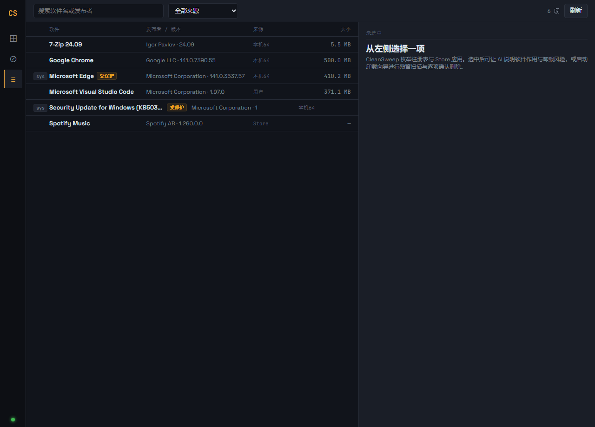
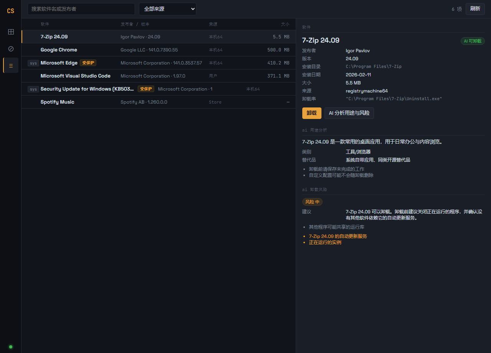
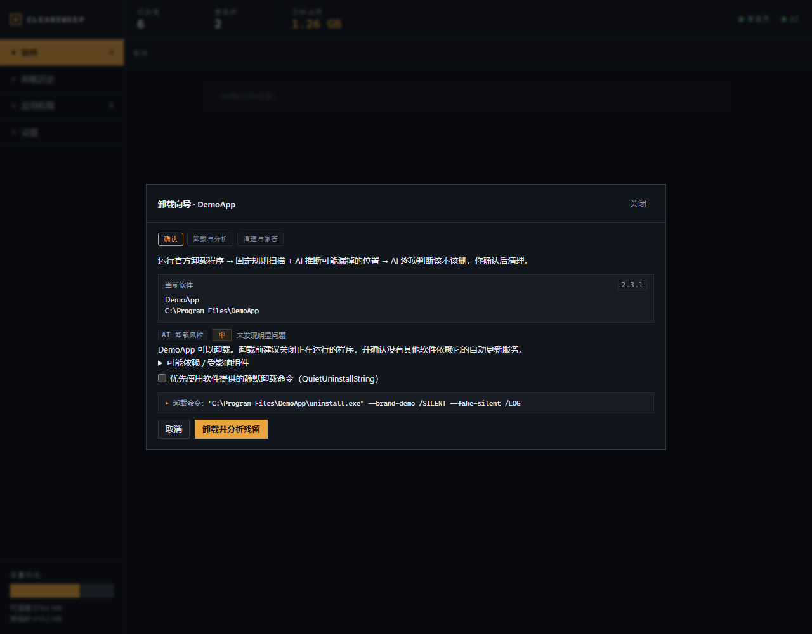
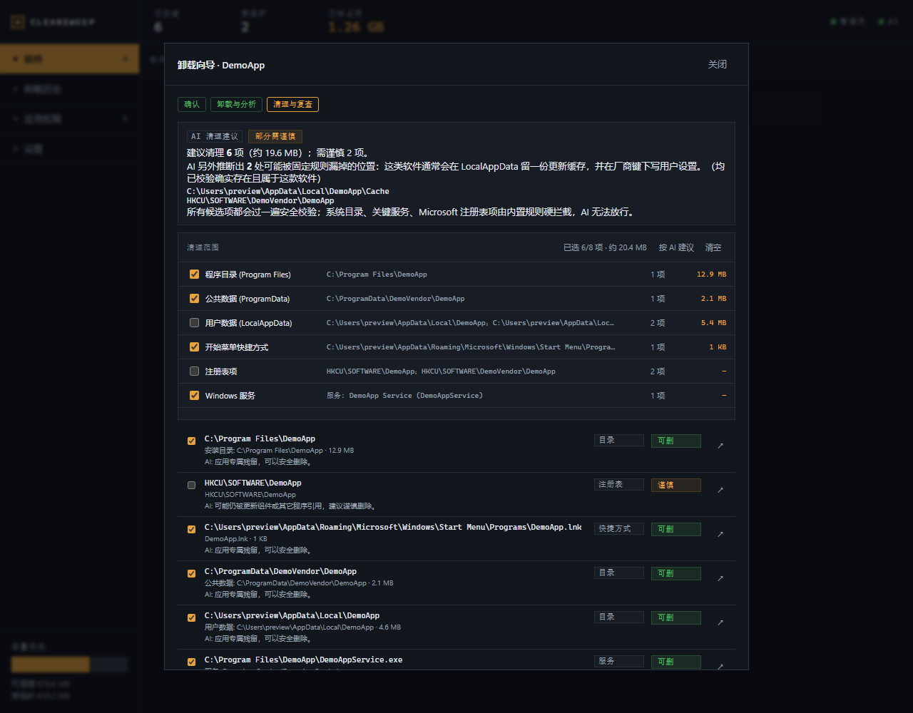
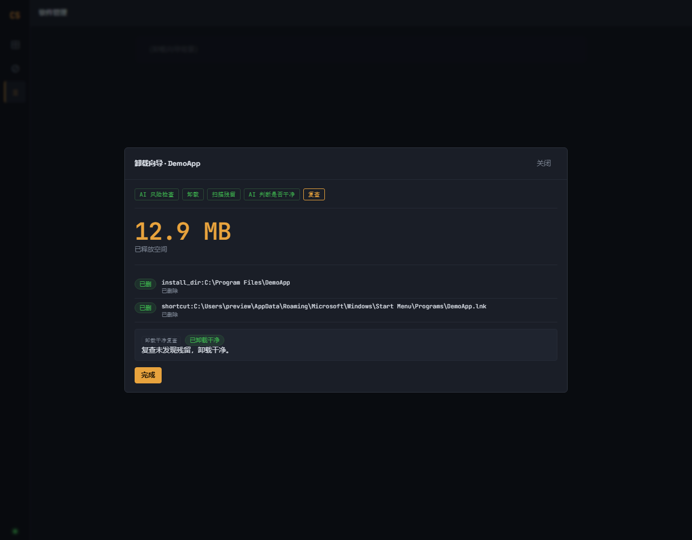
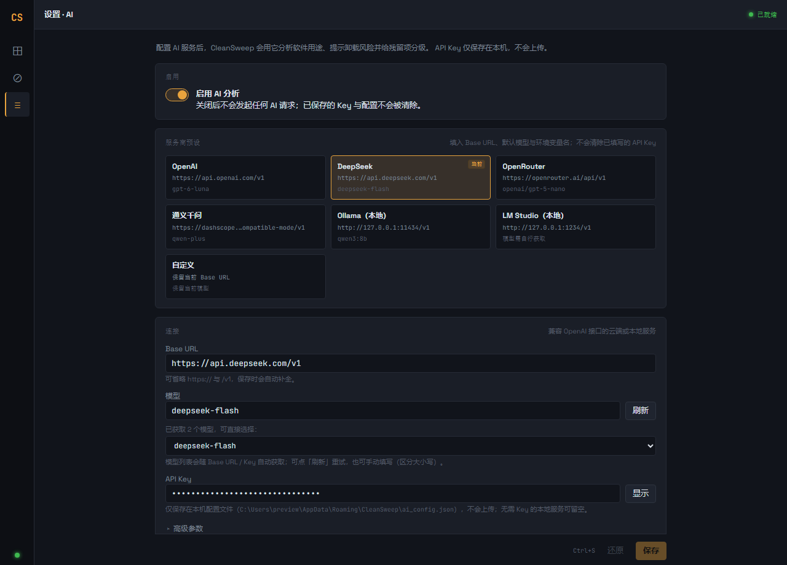
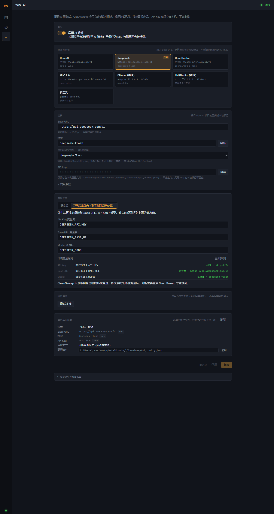

# CleanSweep

**更安全的 Windows 卸载与清理工具——先让 AI 看清楚，再动手清理。**

CleanSweep 是一款面向普通用户的 Windows 桌面工具：列出电脑上安装的软件，帮你把软件卸载干净，清理残留文件与注册表，并管理应用的联网、系统权限和开机自启。所有删除操作都必须由你确认；AI 只给建议，不会替你做决定。

> AI-assisted Windows uninstaller & cleaner. Local-first, confirmation-first, AI optional.

Windows 10 / 11（x64）· 需要管理员权限 · 无需注册账号 · AI 功能可选

---

## 它解决什么问题

Windows 自带的"卸载"经常留下三类东西：

1. **目录残留**：`Program Files`、`ProgramData`、`AppData` 里的应用目录；
2. **注册表残留**：软件在 `HKCU/HKLM\SOFTWARE` 下留下的配置键；
3. **后台残留**：卸载后还在的自启项、服务或计划任务。

CleanSweep 的流程是：**卸载前让 AI 评估风险 → 运行官方卸载程序 → 扫描残留并展示"到底要清理哪些目录/数据" → AI 判断是否卸载干净 → 你逐项勾选确认 → 删除后自动复查**。

---

## 界面截图

### 软件列表与 AI 分析

列出已安装软件、发布者、版本、来源和大小；系统组件/更新/驱动/运行库会标记为「受保护」，禁止卸载。



选中软件后，可让 AI 解释它的用途、卸载风险、依赖项和替代品。



### 卸载前：AI 风险检查 + 清理范围说明

打开卸载向导会自动让 AI 评估卸载风险（低/中/高/极高、依赖、可能受影响的组件），高风险需要你额外确认。**扫描 / 清理范围默认展开**，包含当前软件的已知安装目录与各类数据位置；需要勾选「我已了解扫描 / 清理范围」后才能开始卸载。

向导还会显示**实际会执行的卸载命令**（来自软件注册信息）。静默卸载默认不勾选；如果这条命令本身带有 `/SILENT`、`/VERYSILENT` 等参数，会明确提示"这是软件自带的静默参数，CleanSweep 不会修改它"。



### 卸载后：展示要清理的目录与数据

扫描完成后，先按"程序目录 / 公共数据 / 用户数据 / 开始菜单 / 注册表 / 服务"分组展示**每一项涉及的位置、数量和占用空间**，再列出具体条目。每一类都可以一键全选/取消，顶部支持全选/清空，具体条目仍可逐项勾选——**确认哪些内容会被清理后再删除**。



### 删除后自动复查

清理完成会自动再扫描一次：显示「已卸载干净」，或提示还有多少残留并允许继续清理。



### 应用权限管理

**联网控制**：为指定程序添加/恢复 Windows 防火墙阻止规则。  
**Store 能力**：控制 Store/UWP 应用的位置、摄像头、麦克风等权限（允许/拒绝/询问）。  
**自启动**：管理注册表 Run/RunOnce 与计划任务，可禁用（备份后可恢复）或删除。


### AI 设置（可选）

内置 OpenAI / DeepSeek / OpenRouter / 通义千问 / Ollama / LM Studio 预设；自动获取模型列表，支持环境变量和自定义 Base URL，API Key 只保存在本机。




---

## 清理范围与数据说明

这是 CleanSweep 最重要的部分：**它到底会看什么、动什么、不会动什么。**

### 扫描的位置

| 位置 | 说明 |
| --- | --- |
| 安装目录 | 注册表 `InstallLocation` 记录的软件安装目录 |
| Program Files / Program Files (x86) | 与应用同名的厂商目录或应用目录 |
| ProgramData | 公共应用数据目录（仅应用专属子目录） |
| LocalAppData / Roaming | 当前用户的软件数据目录（仅应用专属子目录） |
| 开始菜单 Programs | 与应用相关的快捷方式（仅 `.lnk`） |
| 注册表 | `HKCU/HKLM\SOFTWARE` 下与应用同名的专属键，以及厂商键下的应用子键 |
| 服务 | 可执行文件不在 Windows 目录、且不是系统关键服务的服务 |
| 计划任务 | 非 Windows 内置任务（`\Microsoft\*` 一律排除） |

### 删除前的保护规则

CleanSweep 会**主动排除**以下内容，即使扫描规则误判也不会展示或删除：

- Windows 系统目录（`C:\Windows`、System32、WinSxS、WindowsApps、Common Files 等）；
- 注册表中的 `Microsoft`、`Classes`、`Policies`、`CurrentVersion\Uninstall` 等系统子树；
- 系统关键服务（RPC、DCOM、EventLog、Defender、防火墙等）与驱动服务；
- `\Microsoft\...` 下的 Windows 内置计划任务；
- 系统组件、Windows 更新/补丁（KB）、驱动包、.NET/VC++ 运行库、内置浏览器、不可移除的 Store 系统包。

此外，所有路径在删除前都会解析真实位置，拒绝 junction/符号链接、8.3 短名、结尾点/空格、UNC 和 `\\?\` 前缀；只有本次扫描确认过的条目才允许删除，前端传入的路径不会被直接信任。

### AI 会看到什么

只有配置并启用 AI 时才会发起请求，发送内容仅限：

- 软件名、发布者、版本、安装目录、卸载串；
- 待评估的残留项：路径、类型、大小等元信息；
- 你当前配置的服务商地址与模型名。

**不会上传文件内容，也没有账号或遥测。** API Key 只保存在本机配置文件中，调用 AI 时只会作为鉴权信息发送给你自己配置的服务商。AI 的返回只用于展示风险与建议，不会自动勾选或自动删除。

配置文件位置：`%APPDATA%\CleanSweep\ai_config.json`（仅本地；原子写入，损坏会自动备份为 `.bak`）。

---

## 下载与安装

从 GitHub **Releases** 下载最新版本：

| 文件 | 适用场景 |
| --- | --- |
| `CleanSweep_<version>_x64-setup.exe` | 普通用户，双击安装（推荐） |
| `CleanSweep_<version>_x64_en-US.msi` | 企业批量部署 / MSI 安装 |
| `CleanSweep.exe` | 免安装绿色版 |

安装或运行后，Windows 会请求管理员权限（UAC）。这是必要的，因为卸载 HKLM 软件、删除 Program Files/注册表、修改防火墙都需要管理员权限。

> 当前安装包**未做代码签名**，SmartScreen 可能提示"Windows 已保护你的电脑"。点击「更多信息 → 仍要运行」即可。  
> 系统要求：Windows 10 1809+ / Windows 11，x64；WebView2 运行时（Win11 自带）。

---

## 使用指南（推荐流程）

1. **配置 AI（可选但推荐）**：设置 → AI，选一个服务商，填 API Key，点「测试连接」，保存。Ollama / LM Studio 本地服务可以不填 Key。
2. **选择软件**：软件管理 → 搜索/筛选 → 选中要卸载的软件。
3. **卸载前检查**：点「卸载」，向导会先显示 AI 风险评估和默认展开的扫描/清理范围；勾选「我已了解扫描/清理范围」后才能开始，高风险还需额外确认。
4. **运行卸载**：优先使用软件自带的静默卸载参数；没有则运行交互式卸载器。
5. **查看清理范围**：卸载完成后扫描残留，先看「本次将清理的目录与数据」总览（可按类别全选/清空），再逐项勾选具体条目。
6. **确认删除**：点「删除选中」，确认对话框会再次列出分组和全部路径。
7. **复查**：完成后自动复查，显示「已卸载干净」或仍需清理的项目。
8. **权限管理（可选）**：应用权限页可禁止程序联网、调整 Store 能力、禁用自启动。

---

## 常见问题

**Q：AI 是必需的吗？**  
不是。不配置 AI 时，软件列表、卸载、残留扫描、清理、权限管理都正常可用，只是没有卸载前风险提示和残留 AI 判断。

**Q：为什么需要管理员权限？**  
卸载系统级软件、删除 `Program Files`/`HKLM` 注册表、修改防火墙规则都需要。程序启动时会请求 UAC，拒绝则只能查看、无法执行清理。

**Q：提示 "请求的操作需要提升（os error 740）" 怎么办？**  
说明当前进程没有管理员权限。CleanSweep **启动时会主动弹 UAC 请求管理员权限**；如果你当时点了「否」，就会以普通权限运行，卸载器需要提权时便会报 740。重新启动程序并在 UAC 弹框选择「是」即可；也可以在「以管理员身份运行」的终端里执行 `pnpm tauri dev`。安装版（release）自带 `requireAdministrator` manifest，双击启动同样会弹 UAC。

**Q：会不会把 Windows 系统文件删掉？**  
CleanSweep 对系统目录、系统注册表、关键服务、Windows 内置任务和系统组件都有硬性保护；但删除操作不可撤销，请在确认前仔细核对路径。建议先在虚拟机或系统快照中试用。

**Q：为什么有些软件显示「受保护」不能卸载？**  
系统组件、更新补丁、驱动、.NET/VC++ 运行库、内置浏览器、不可移除的 Store 系统包被标记为受保护。卸载它们可能导致其他软件或系统功能异常，因此界面和后端都会拒绝。

**Q：卸载后还有残留怎么办？**  
在向导里重新扫描；被占用/需要重启的文件会在复查中提示，可重启后再次清理。

**Q：需要联网吗？**  
除 AI 功能和"获取模型列表"外，其他功能完全本地运行。程序启动时不再加载外部字体/资源。

**Q：为什么取消勾选"静默卸载"还是没弹出卸载界面？**  
"静默"可能来自软件自己的注册表卸载命令。CleanSweep 会在向导里显示**实际会执行的命令**；如果它本身包含 `/SILENT`、`/VERYSILENT` 等参数，即使取消勾选也会静默执行——这是软件自带的卸载命令，CleanSweep 不会修改它。只有软件额外提供了 `QuietUninstallString` 时，向导里的"优先使用静默卸载命令"才会切换到另一条命令。

**Q：卸载/删除能撤销吗？**  
不能。文件删除不可恢复；自启动"禁用"会保留可恢复的备份，但"删除"不可撤销。请按需勾选。

---

## 从源码构建

### 环境要求

- Node.js 20+、[pnpm](https://pnpm.io/)
- Rust stable（rustup）+ Visual Studio Build Tools（勾选「使用 C++ 的桌面开发」）
- WebView2 Runtime

```bash
pnpm install

# 开发模式（Vite + Tauri 窗口）
# 启动时会自动弹 UAC 请求管理员权限；取消则继续以普通权限运行（顶部提示）。
pnpm tauri dev

# 构建前端
pnpm build

# 构建 Windows 安装包（release 版本会嵌入 requireAdministrator，自动请求 UAC）
pnpm tauri build
```

产物：

- `src-tauri/target/release/windows-clean.exe`（主程序）
- `src-tauri/target/release/bundle/msi/*.msi`
- `src-tauri/target/release/bundle/nsis/*-setup.exe`

---

## 发布：推送 tag 自动打包

仓库内置 GitHub Actions：

| 工作流 | 触发 | 作用 |
| --- | --- | --- |
| `.github/workflows/release.yml` | 推送 `v*` tag | 在 `windows-latest` 构建并创建 GitHub Release，上传 MSI / NSIS 安装包 / 绿色版 exe |
| `.github/workflows/ci.yml` | push 到 `main`/`master`、PR | 前端构建 + Rust 检查 + 单元测试 |

### 一键发版（推荐）

仓库根目录带一个 `Makefile` 和 `tools/tag-release.ps1`。确认当前改动都已提交、工作区干净后执行：

```bash
make tag v0.0.3
```

它会自动完成：

1. 校验版本号格式（`vX.Y.Z`）、当前分支、origin 远程与 tag 是否已存在；
2. 同步版本号：`package.json`、`src-tauri/tauri.conf.json`、`src-tauri/Cargo.toml`（同时更新 `Cargo.lock`）；
3. 提交 `release: v0.0.3`；
4. 推送当前分支；
5. 创建并推送 tag `v0.0.3`，触发 GitHub Actions；
6. CI 构建出的文件名自动使用该版本，例如 `CleanSweep_0.0.3_x64-setup.exe`、`CleanSweep_0.0.3_x64_en-US.msi`。

只想预演、不改仓库：

```bash
make tag v0.0.3 DRY_RUN=1
```

其他常用命令：

```bash
make build    # 本地构建前端 + Tauri 安装包（NSIS / MSI）
make check    # 前端构建 + Rust 单元测试
```

> 如果分支已推送、但 tag 推送因网络/TLS 波动失败，修复网络后重新执行同一条命令即可：脚本检测到版本号已匹配时会跳过提交，并自动重试 3 次推送 tag。  
> 首次使用前，请先把 `Makefile`、`tools/tag-release.ps1` 以及当前改动提交到仓库——脚本会拒绝有未提交修改的工作区，避免发版内容被漏掉。  
> Windows 需要 GNU Make：Git Bash 一般自带；也可以 `choco install make` 或 `scoop install make`。  
> 没有 make 时可直接运行：  
> `powershell -NoProfile -ExecutionPolicy Bypass -File tools/tag-release.ps1 -Version v0.0.3`  
> 脚本要求工作区干净（先 commit 你的改动），版本号只支持 `X.Y.Z` 数字格式，且 tag 不能已存在。

### 手动发布（不使用脚本）

1. 仓库 **Settings → Actions → General → Workflow permissions** 设为 **Read and write permissions**。
2. 同步 3 处版本号：`package.json`、`src-tauri/tauri.conf.json`、`src-tauri/Cargo.toml`。
3. 提交后打 tag（tag 名与版本号保持一致）：

```bash
git tag v0.0.3
git push origin v0.0.3
```

Release 会自动生成并附带：

- `CleanSweep_<version>_x64-setup.exe`（NSIS 安装包）
- `CleanSweep_<version>_x64_en-US.msi`（MSI）
- `CleanSweep.exe`（绿色版）

> 代码签名/自动更新暂未启用；可在 workflow 中配置 `TAURI_SIGNING_PRIVATE_KEY` 等 secrets。

---

## 安全与隐私承诺

- 所有破坏性操作（卸载、删除文件/目录/注册表/服务/任务、修改防火墙、禁自启动）都需要你确认。
- AI 只提供建议，**不会自动勾选、不会自动删除**。
- 不收集账号、不上传文件内容、无遥测。
- API Key 与配置只保存在本机 `%APPDATA%\CleanSweep\ai_config.json`。
- 扫描/删除路径经过多轮安全校验，系统目录与系统组件默认拒绝。

### 已知限制

- 安装包未签名，SmartScreen 会提示。
- 部分卸载器会启动子进程后立即退出。CleanSweep 在卸载程序退出后，会继续等待应用进程与安装记录消失（最多 10 分钟）再扫描残留；个别卸载器仍可能超出等待时间，此时会提示你等卸载器结束/重启后再扫描。
- "最近卸载"记录只保存在当前会话内存中；重启后无法继续对已卸载软件做残留复查。
- 严格 CSP 尚未启用；建议只从 Releases 下载并使用。
- 建议先在虚拟机/系统快照中验证，再用于重要环境。

---

## 技术栈与项目结构

- Tauri 2 + Rust（Windows API / 注册表 / 服务 / 防火墙 / Store）
- React 18 + TypeScript + Vite
- OpenAI 兼容 AI 接口（可选，不绑定特定厂商）

```
src/                    React 前端（软件管理 / 卸载向导 / 权限 / 设置）
src-tauri/src/          Rust 后端（枚举、卸载、残留扫描、服务/任务、安全护栏、AI）
src-tauri/capabilities/ Tauri 权限
docs/screenshots/       README 截图
tools/                  开发辅助（浏览器预览截图、图标生成）
.github/workflows/      发布与 CI
```

开发辅助说明：`tools/preview` 用 mock 数据在浏览器中预览界面并生成截图，不参与打包；`tools/make-icons.py` 用于重新生成应用图标。

---

## 贡献

欢迎提交 Issue 反馈 bug 或建议。提交 PR 前请确保：

```bash
pnpm build                          # 前端构建通过
cd src-tauri && cargo test --lib    # Rust 测试通过
```

## 许可证

本项目暂未声明开源许可证；如需在其它项目中使用/分发，请先联系作者。

## 免责声明

本工具会执行软件卸载与文件/注册表/服务/任务的删除操作。请在使用前备份重要数据，并在充分理解确认内容后操作。作者不对因使用本工具造成的数据丢失或系统问题承担责任。
