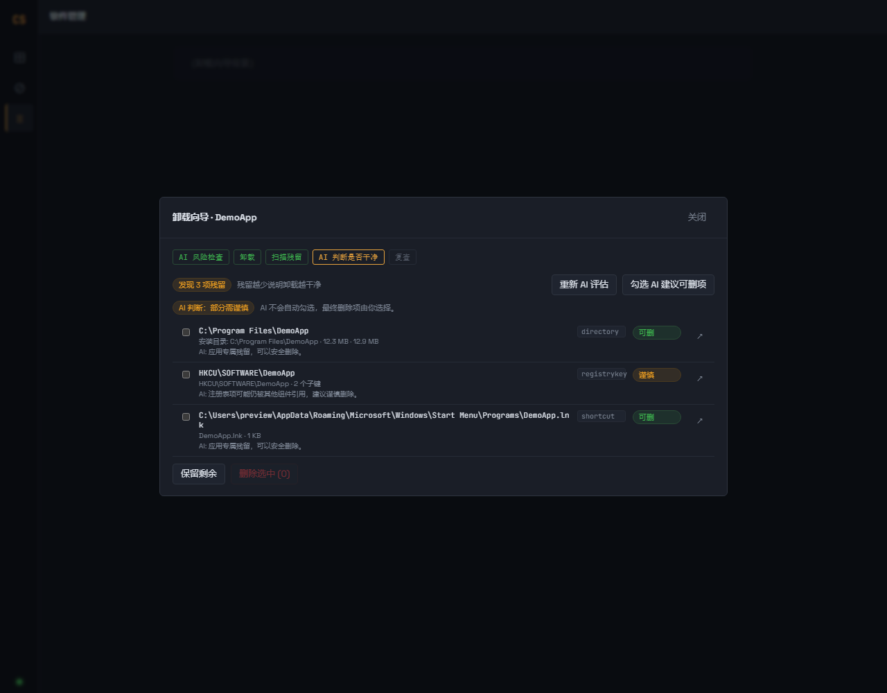

# CleanSweep

> AI 辅助的 Windows 卸载、残留清理与权限管理工具。Tauri 2 + React + Rust，本地优先，AI 可选。

Windows 10 / 11 (x64) · 需要管理员权限 · 单文件界面 · 无遥测、无云端上传

---

## 截图

**软件列表 + 受保护条目识别 + AI 用途/风险分析**


**卸载前 AI 风险检查 → 卸载 → 扫描残留 → AI 判断是否卸载干净 → 删除后复查**





**应用权限：防火墙联网控制 / Store 能力 / 自启动管理**


**AI 设置：服务商预设、自动获取模型、环境变量、连接测试、高级参数**


---

## 功能

### 软件管理

- **软件枚举**：注册表 Uninstall 键（HKLM 64/32 位、HKCU）+ Store/MSIX 应用列表，显示发布者、版本、来源、安装大小与日期。
- **搜索 / 来源过滤**：按名称或发布者搜索，按当前用户 / 本机 / Store / 系统组件过滤。
- **受保护条目识别**：系统组件、Windows 更新/补丁（KB）、驱动包、.NET / VC++ 运行库、内置浏览器、不可移除的 Store 系统/框架包会标记为「受保护」，**界面禁用卸载，后端也会再次拒绝**。
- **安全卸载**：卸载前 AI 风险评估 → 运行官方卸载程序（优先生成静默串）→ 自动扫描残留 → AI 判断是否卸载干净 → 逐项确认删除 → 删除后自动复查。

### 卸载与残留清理

- 卸载串只使用后端按 app id 重新枚举得到的系统数据；拒绝 `cmd/powershell/脚本/系统目录程序/UNC` 等危险入口；`msiexec` 仅允许 System32 下 `/x`；Store 包会实时复核是否为系统/框架/不可移除包。
- 残留扫描覆盖：安装目录、Program Files / ProgramData / LocalAppData / Roaming、开始菜单快捷方式、`HKCU/HKLM\SOFTWARE` 应用专属键、非系统服务、非 Windows 内置计划任务。
- **卸载前 AI 风险检查**（打开向导自动执行）：风险等级、依赖、受影响组件、建议；高风险必须勾选确认后才能继续。
- **卸载后 AI 判断是否干净**：扫描后自动逐项评估（可删/谨慎/保留/未知）并给出总体结论；支持「勾选 AI 建议可删项」（仍需用户确认）。
- **清理后自动复查**：删除完成后再次扫描，显示「已卸载干净」或「仍有 N 项残留」，可继续清理。
- AI 只作为建议层：**不自动勾选、不自动删除**。

### 应用权限

- **防火墙联网控制**：为指定 exe 添加/移除 Windows 防火墙出入站阻止规则（`CleanSweep_Block_*`），可在本页恢复；拒绝操作 Windows 系统程序。
- **Store 应用能力**：通过 ConsentStore 控制位置/摄像头/麦克风/账户信息等 capability（允许 / 拒绝 / 询问），未设置过的能力也可首次设置。
- **自启动管理**：扫描注册表 Run/RunOnce 与计划任务；可禁用（注册表备份为 `disabled_` 前缀 / 任务 `/DISABLE`）或永久删除；只允许操作固定的 Run 键，Windows 内置任务受保护。

### AI 配置

- 预设 OpenAI / DeepSeek / OpenRouter / 通义千问 / Ollama / LM Studio / 自定义，自动填入 Base URL、当前模型与环境变量名。
- Base URL 自动补全（可省略 `https://` 与 `/v1`），模型列表**自动获取**并可直接选择，也可手动填写。
- 支持「环境变量优先（取不到回退静态值）」并显示脱敏后的探测结果。
- 连接测试只使用当前表单值，不保存、不改变启用状态，失败时给出 401/404/超时/模型名等排查提示。
- 高级参数：temperature（0~2）、请求超时（5~600 秒）。
- 配置文件：`%APPDATA%\CleanSweep\ai_config.json`（原子写入、旧配置兼容、损坏自动备份 `.bak`），API Key 仅本地保存。

### 安全护栏（防止误删系统）

- 删除只接受**本次扫描确认过**的残留 id（服务端索引），前端传入的路径/类型一律忽略；删除前逐项重新校验。
- 路径校验会 canonicalize 真实路径，拒绝 junction/symlink/重解析点、8.3 短名、结尾点/空格、UNC 与 `\\?\` 前缀；目录树含链接时拒绝整目录删除。
- 注册表只允许 `HKCU/HKLM\SOFTWARE` 下的应用专属键，禁止 `Microsoft`、`Classes`、`Policies`、`CurrentVersion`、`Uninstall` 等系统子树。
- 服务/任务删除前从注册表重读真实 `ImagePath`、重新确认任务存在；关键服务与 `\Microsoft\*` 任务受保护。
- 不直接运行前端传入的任何命令/路径；系统工具全部使用绝对路径调用。

---

## 下载安装

从 GitHub **Releases** 下载：

| 文件 | 说明 |
| --- | --- |
| `CleanSweep_<version>_x64-setup.exe` | NSIS 安装包（推荐） |
| `CleanSweep_<version>_x64_en-US.msi` | MSI 安装包（适合企业部署） |
| `CleanSweep.exe` | 免安装绿色版 |

**系统要求**：Windows 10 1809+ / Windows 11，x64；WebView2 运行时（Win11 自带，旧版 Win10 安装程序会自动处理）。

> 程序以管理员权限运行（manifest `requireAdministrator`），因为卸载 HKLM 软件、删除 Program Files/注册表、防火墙规则都需要管理员权限。安装包未做代码签名，首次运行 SmartScreen 可能提示，选择「更多信息 → 仍要运行」。

---

## 从源码运行

### 依赖

- Node.js 20+ 与 [pnpm](https://pnpm.io/)
- Rust stable（`rustup`）+ MSVC 工具链（Visual Studio Build Tools，勾选「使用 C++ 的桌面开发」）
- WebView2 Runtime

```bash
pnpm install
# 开发模式（Vite + Tauri 窗口，debug 不请求提权）
pnpm tauri dev
# 仅构建前端
pnpm build
# 构建 Windows 安装包（release 会嵌入 requireAdministrator）
pnpm tauri build
```

产物位置：`src-tauri/target/release/windows-clean.exe`（可执行文件）以及 `src-tauri/target/release/bundle/{msi,nsis}/`。

---

## 发布：推送 tag 自动打包 exe

仓库内置两个 GitHub Actions：

| Workflow | 触发 | 作用 |
| --- | --- | --- |
| `.github/workflows/release.yml` | 推送 `v*` tag | 在 `windows-latest` 上构建并创建 GitHub Release，上传 MSI / NSIS 安装包 / 绿色版 exe |
| `.github/workflows/ci.yml` | push 到 `main`/`master`、PR | `pnpm build` + `cargo check` + `cargo test --lib` |

### 发布步骤

1. 一次性设置：仓库 **Settings → Actions → General → Workflow permissions** 选择 **Read and write permissions**（否则无法创建 Release）。
2. 同步版本号（三处保持一致）：
   - `package.json` 的 `version`
   - `src-tauri/tauri.conf.json` 的 `version`
   - `src-tauri/Cargo.toml` 的 `version`
3. 提交并推送后打 tag：

```bash
git tag v0.1.0
git push origin v0.1.0
```

推送 tag 后，Release 会自动创建并附带：

- `CleanSweep_0.1.0_x64_en-US.msi`
- `CleanSweep_0.1.0_x64-setup.exe`（NSIS）
- `CleanSweep.exe`（绿色版）

> 可选：代码签名/自动更新需要额外配置 `TAURI_SIGNING_PRIVATE_KEY` 等 secrets，并在 workflow 中启用；当前模板未开启。

---

## 配置 AI（可选）

1. 打开「设置 → AI」，选择服务商预设（如 DeepSeek），填入 API Key；Ollama / LM Studio 等本地服务可留空 Key。
2. 点「测试连接」确认可用（只测试当前表单值，不保存）。
3. 保存后：软件详情页可「AI 分析用途与风险」；卸载向导会自动做卸载前风险检查与卸载后残留判断。

未配置 AI 时，软件枚举、卸载、残留扫描、权限管理全部照常工作，只是没有 AI 提示。

---

## 项目结构

```
.
├─ .github/workflows/        GitHub Actions（release.yml / ci.yml）
├─ docs/screenshots/         README 截图
├─ src/                      React 前端
│  ├─ views/                 软件管理 / 卸载向导 / 权限 / 设置
│  ├─ components/            Confirm 弹窗、Toast
│  ├─ bindings.ts            Tauri 命令封装与类型
│  └─ styles.css             设计系统（深色仪器风）
├─ src-tauri/                Rust 后端
│  ├─ src/registry.rs        注册表软件枚举/删除
│  ├─ src/store.rs           Store/MSIX 枚举与卸载
│  ├─ src/uninstall.rs       卸载串解析与执行
│  ├─ src/residuals.rs       残留扫描（只读）
│  ├─ src/services.rs        服务/计划任务扫描与删除
│  ├─ src/autostart.rs       自启动项管理
│  ├─ src/firewall.rs        防火墙规则
│  ├─ src/capabilities.rs    ConsentStore 能力
│  ├─ src/ai.rs              OpenAI 兼容 AI 客户端
│  ├─ src/safety.rs          安全护栏（路径/注册表/服务/任务/卸载校验）
│  ├─ src/config.rs          AI 配置持久化
│  ├─ icons/                 应用图标（可用 tools/make-icons.py 重新生成）
│  └─ tauri.conf.json        Tauri 配置
├─ tools/preview/            仅开发用：浏览器预览 + 截图（mock Tauri 命令，不参与打包）
├─ tools/make-icons.py       开发用：生成 PNG/ICO 图标
└─ package.json
```

---

## 已知限制与安全说明

- **AI 结论仅供参考**，不自动执行删除，也不会自动勾选待删项（模型输出可能被提示注入，仅作为展示）。
- 所有删除/卸载操作都会弹出确认对话框；删除不可撤销，请按需勾选。
- 部分卸载器会启动子进程后立即退出，此时残留扫描可能早于卸载完成；如发现残留，重新扫描/清理即可。
- 当前未启用严格 CSP；HKCU 用户可写的卸载条目在管理员进程中执行属于潜在提权面（建议只卸载可信软件）。
- 建议先在虚拟机/系统快照中验证卸载与清理流程，再用于生产环境。
- 本项目主要面向 Windows；其他平台未做支持。
- 未配置 AI 时，卸载前风险检查 / 残留 AI 判断会显示不可用，但扫描与清理正常工作。

## 免责声明

本工具会执行软件卸载与文件/注册表/服务/任务的删除操作。请在使用前备份重要数据，并在充分理解确认内容后操作。作者不对因使用本工具造成的数据丢失或系统问题承担责任。
