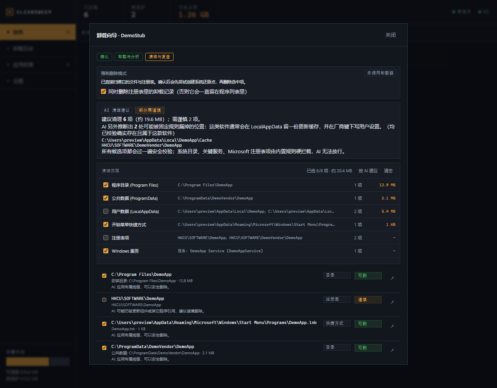
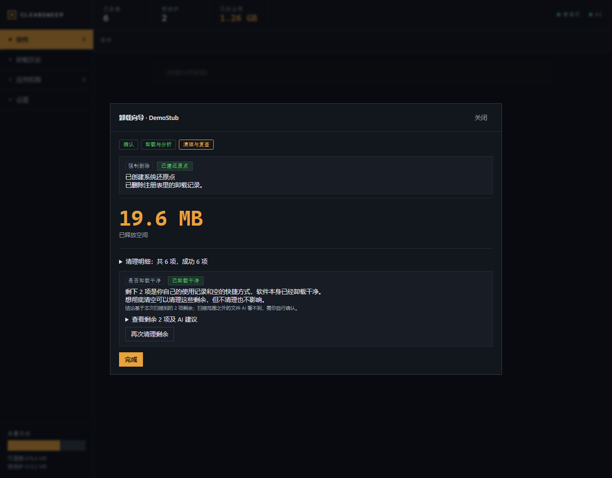
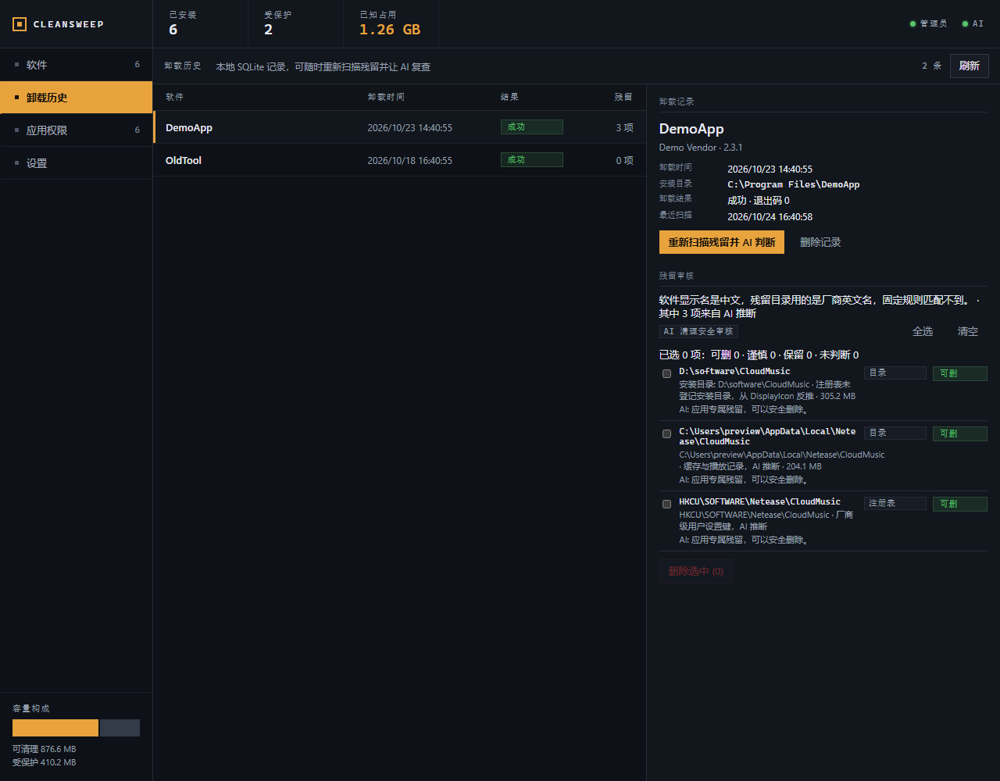
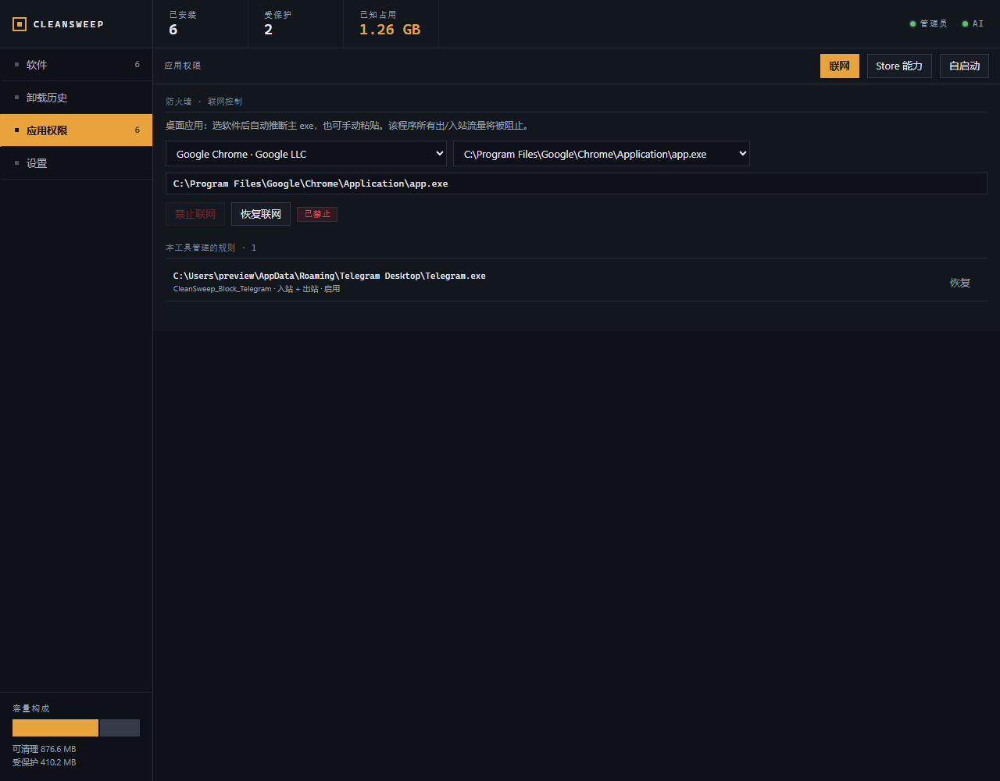
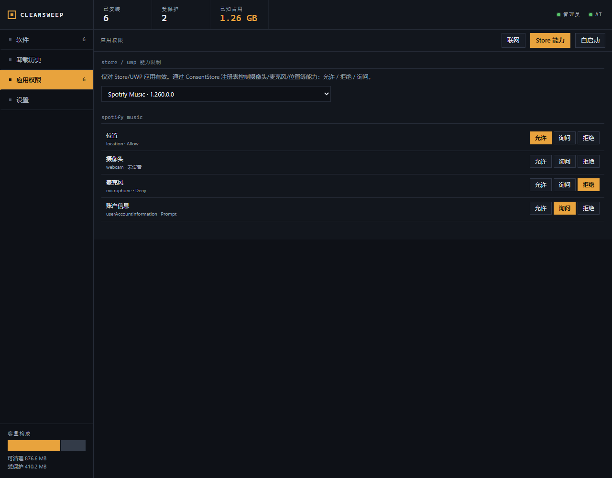
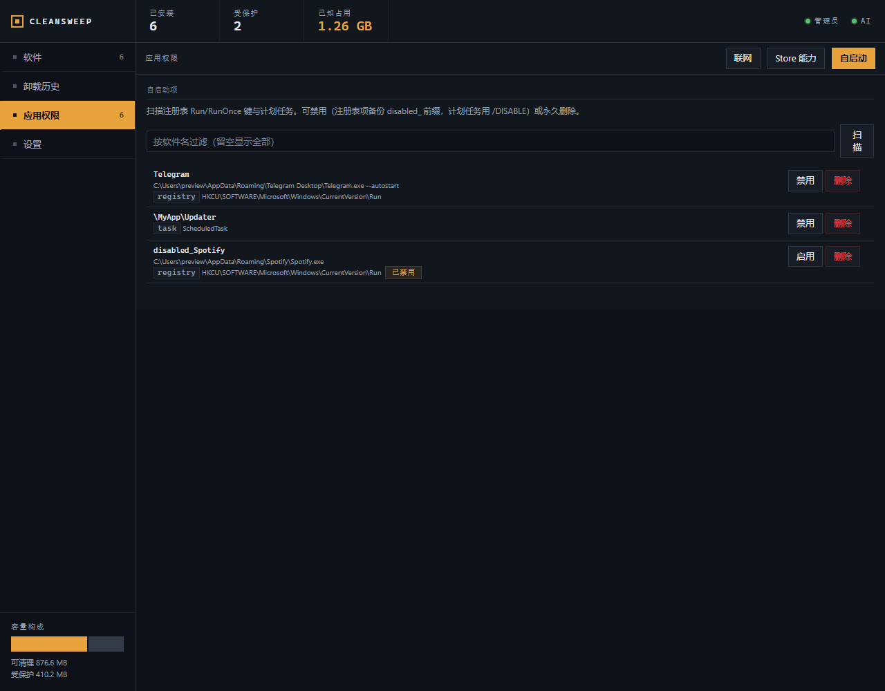

# CleanSweep 详细说明

[README](../README.md) 讲「是什么、怎么用」，这里放「具体扫什么、判什么、有哪些坑」。

## 清理范围

### 扫描的位置

| 位置 | 说明 |
| --- | --- |
| 安装目录 | 注册表 `InstallLocation` 记录的软件安装目录 |
| Program Files / Program Files (x86) | 与应用同名的厂商目录或应用目录 |
| ProgramData | 公共应用数据目录（仅应用专属子目录） |
| LocalAppData / Roaming | 当前用户的软件数据目录（仅应用专属子目录） |
| 开始菜单 Programs | 与应用相关的快捷方式（仅 `.lnk`） |
| 注册表 | `HKCU/HKLM\SOFTWARE` 下与应用同名的专属键，以及 `Run/RunOnce` 中与应用相关的启动值 |
| 服务 | 可执行文件不在 Windows 目录、且不是系统关键服务的服务 |
| 计划任务 | 非 Windows 内置任务（`\Microsoft\*` 一律排除） |

### 匹配靠什么线索

同时使用：应用显示名、发布者、**安装目录 / 卸载命令推导出的英文别名**，以及安装目录的父目录。

所以即使软件显示名是中文（如「夸克」）、实际目录是英文（`QuarkUpdater`、`quark-cloud-drive`），也能识别出更新器、伴随组件和同级目录。计划任务与服务还会按命令行里的安装路径或别名匹配，而不只看任务名。

注册表里没登记 `InstallLocation` 时，会从 `DisplayIcon` / 卸载命令反推安装目录，避免安装目录本体被整个跳过。

## 删除前的保护规则

CleanSweep 会**主动排除**以下内容，即使扫描规则误判也不会展示或删除：

- Windows 系统目录（`C:\Windows`、System32、WinSxS、WindowsApps、Common Files 等）；
- 注册表中的 `Microsoft`、`Classes`、`Policies`、`CurrentVersion\Uninstall` 等系统子树；
- 系统关键服务（RPC、DCOM、EventLog、Defender、防火墙等）与驱动服务；
- `\Microsoft\...` 下的 Windows 内置计划任务；
- 系统组件、Windows 更新 / 补丁（KB）、驱动包、.NET / VC++ 运行库、内置浏览器、不可移除的 Store 系统包。

此外，所有路径在删除前都会解析真实位置，拒绝 junction / 符号链接、8.3 短名、结尾点或空格、UNC 和 `\\?\` 前缀；只有本次扫描确认过的条目才允许删除，前端传入的路径不会被直接信任。

> 唯一例外是强制删除里的「清理卸载记录」：它只按当前枚举结果定位 `...\CurrentVersion\Uninstall\<条目>`，只允许一层子键，且要求键里的 `DisplayName` 完全一致。

## AI 会看到什么

只有配置并启用 AI 时才会发起请求，发送内容仅限：

- 卸载前风险判定：软件名、发布者、版本、安装目录、卸载命令、静默卸载命令、预计大小、注册表卸载键；
- 卸载后残留审核：待评估残留项的路径、类型、大小等元信息；
- 你当前配置的服务商地址与模型名。

**不会上传文件内容，也没有账号或遥测。** API Key 只保存在本机配置文件中，调用 AI 时只会作为鉴权信息发送给你自己配置的服务商。AI 的返回只用于展示风险与建议：它会按判定预勾选残留项（可逐项取消、可一键清空），但不会自行提交删除，确认框始终由你点。

配置文件位置：`%APPDATA%\CleanSweep\ai_config.json`（仅本地；原子写入，损坏会自动备份为 `.bak`）。

## 强制删除

注册表里没有卸载命令、卸载程序文件已经丢失、或者卸载器跑不起来时，普通卸载工具只能报错退出——而这恰恰是残留最多的那类软件。

- 不运行卸载器，直接扫描并列出它的文件、注册表项、服务与计划任务，勾选后删除；
- **删除前先创建系统还原点**。系统保护未开启、当前不是管理员、或 24 小时内刚建过时，完成页会写明真实原因，不假装成功；
- 可选顺带删掉注册表里的卸载记录，否则它会一直挂在软件列表里；
- 卸载器跑失败时，失败页也提供「强制删除」入口，不用关掉重开向导。

强制删除不会执行软件自己的清理步骤：可能漏掉它自定义的位置，也可能删掉你仍想保留的配置。出问题只能靠还原点恢复，所以别跳过那一步。




## 卸载历史

左列是记录（软件名、卸载时间、结果、残留数），右列是选中记录的软件快照、残留清单与 AI 复查结论。每次通过 CleanSweep 卸载软件都会写入本地 SQLite：

- 数据库：`%APPDATA%\CleanSweep\history.db`
- 记录软件快照（名称、发布者、版本、安装目录、卸载命令）、卸载时间、结果、退出码，以及当次扫描到的残留
- 即使程序重启、软件已从系统消失，也可以在「卸载历史」里重新扫描残留
- 右上角「重新扫描残留并 AI 判断」跑的是**固定规则 + AI 推断**：软件卸载后可用线索会变少，只按名字匹配很容易漏（比如「网易云音乐」的残留目录叫 `Netease`，两边一个字都对不上）
- AI 推断没跑通时，界面会明确写「结论只来自固定规则，可能漏报」，不会把 0 项说成已经清理干净
- 「删除记录」只删除本地历史，不会删除软件或残留文件



## 应用权限管理

- **联网控制**：为指定程序添加 / 恢复 Windows 防火墙阻止规则。
- **Store 能力**：控制 Store / UWP 应用的位置、摄像头、麦克风等权限（允许 / 拒绝 / 询问）。
- **自启动**：管理注册表 Run / RunOnce 与计划任务，可禁用（备份后可恢复）或删除。





## 常见问题

**Q：AI 是必需的吗？**
卸载必需，其余功能不依赖。未配置 AI 时，软件列表、应用权限、卸载历史浏览都正常可用，但卸载向导会拦住「卸载并分析残留」——清理阶段要求 AI 逐项判断，不做「跳过 AI」的降级。只想保留本地环境时可以配 Ollama / LM Studio，不必上云端。

**Q：AI 会不会编造一个不存在的路径让我删？**
不会进入可删清单。AI 推断出的每条路径都要过后端校验：必须**真实存在**、必须是绝对路径且不是 junction / 符号链接、必须通过安全路径校验、必须落在已知的应用数据或程序根目录下、不能是其他已安装软件的目录、名字（自身或父目录）必须与这款软件有关联；注册表项还必须能真正打开且最后两段与软件相关。任何一条不过就静默丢弃，不会以「也许能删」的形式出现。真正删除时还会再校验一次，并且只认本次扫描的后端索引。

**Q：能同时卸载多个软件吗？**
不能，一次只处理一个。多个卸载器并发跑会互相争抢同名进程与文件锁，而且「卸载是否真正结束」会判断不准（扫描早一步就会一边删一边写），所以界面上没有批量入口。

**Q：卸载时会执行什么命令？**
只执行注册表里登记的卸载串，并且执行前会再校验一遍：系统工具（`cmd` / `powershell` / `wscript` 等）不能当卸载入口、`.bat` / `.ps1` / `.msi` 等脚本与安装包不能直接跑、不能是 UNC 路径或 Windows 目录下的程序；`msiexec` 只允许 `/x` 卸载且必须是 System32 目录里的那个。参数是逐个传给子进程的，不经过 shell 拼接。

**Q：为什么需要管理员权限？**
卸载系统级软件、删除 `Program Files` / `HKLM` 注册表、修改防火墙规则都需要。程序启动时会请求 UAC，拒绝则只能查看、无法执行清理。

**Q：提示「请求的操作需要提升（os error 740）」怎么办？**
说明当前进程没有管理员权限。CleanSweep 启动时会主动弹 UAC；如果你当时点了「否」，就会以普通权限运行，卸载器需要提权时便会报 740。重启程序并在 UAC 弹框选「是」即可；也可以在「以管理员身份运行」的终端里执行 `pnpm tauri dev`。

**Q：会不会把 Windows 系统文件删掉？**
CleanSweep 对系统目录、系统注册表、关键服务、Windows 内置任务和系统组件都有硬性保护；但删除操作不可撤销，请在确认前仔细核对路径。建议先在虚拟机或系统快照中试用。

**Q：为什么有些软件显示「受保护」不能卸载？**
系统组件、更新补丁、驱动、.NET / VC++ 运行库、内置浏览器、不可移除的 Store 系统包被标记为受保护。卸载它们可能导致其他软件或系统功能异常，因此界面和后端都会拒绝。

**Q：卸载后还有残留怎么办？**
卸载失败或没等到卸载结束时，向导会停在失败页，点「仍要扫描残留」即可；已经关掉向导的，到「卸载历史」找到这条记录重新扫描。被占用 / 需要重启的文件会在复查中提示，可重启后再清理。

**Q：需要联网吗？**
除 AI 功能和「获取模型列表」外，其他功能完全本地运行。程序启动时不会加载外部字体或资源。

**Q：为什么取消勾选「静默卸载」还是没弹出卸载界面？**
「静默」可能来自软件自己的注册表卸载命令。CleanSweep 会在向导里显示**实际会执行的命令**；如果它本身包含 `/SILENT`、`/VERYSILENT` 等参数，即使取消勾选也会静默执行——这是软件自带的命令，CleanSweep 不会修改它。只有软件额外提供了 `QuietUninstallString` 时，「优先使用静默卸载命令」才会切换到另一条命令。

**Q：卸载 / 删除能撤销吗？**
不能。文件删除不可恢复；自启动的「禁用」会保留可恢复的备份，但「删除」不可撤销。请按需勾选。

## 已知限制

- 安装包未签名，SmartScreen 会提示。
- 部分卸载器会启动子进程后立即退出。CleanSweep 在卸载程序退出后，会继续等待应用进程与安装记录消失（最多 10 分钟）再扫描残留；个别卸载器仍可能超出等待时间，此时会提示你等卸载器结束或重启后再扫描。
- 扫描靠名字关联：如果残留目录名和软件名完全无关（中文显示名 vs 英文 / 拼音厂商目录名），固定规则会漏掉；这类情况需要 AI 推断补漏，而 AI 推断仍要求路径与软件名有关联证据，极端的命名（如 `D:\software\Netease`）可能搜不到，需要手动定位。
- 名字关联只要求「自身或父目录」命中，且只能排除**仍在枚举中**的其他软件。厂商的另一个产品如果已不在已安装列表里（绿色版、旧版残留），理论上可能被误判成这款软件的残留，确认时请看一眼路径归属。
- 删除走 `remove_dir_all`，**不进回收站，不可恢复**；强制删除的场景只能靠系统还原点兜底。
- 文件关联（`Software\Classes`）和 `App Paths` 里的注册表引用暂未纳入自动扫描 / 删除，目前需要手动清理。
- 「卸载历史」只记录 CleanSweep 自己执行过的卸载，持久化在本地 SQLite（`history.db`）。
- 严格 CSP 尚未启用；建议只从 Releases 下载并使用。
- 建议先在虚拟机 / 系统快照中验证，再用于重要环境。

## 技术栈与项目结构

- Tauri 2 + Rust（Windows API / 注册表 / 服务 / 防火墙 / Store）
- React 18 + TypeScript + Vite（无 UI 组件库、无运行时字体依赖，只用系统字体栈）
- SQLite（rusqlite，本地卸载历史）
- OpenAI 兼容 AI 接口（可选厂商，不绑定具体服务商）

```
src/App.tsx            外壳：顶部读数与状态灯、拨档导航、容量构成
src/views/             软件清单与行内详情 / 卸载历史 / 卸载向导 / 应用权限 / 设置
src/styles.css         全部样式（无 CSS 框架，颜色与字阶集中在顶部变量）
src-tauri/src/         Rust 后端
  uninstall.rs         解析并运行卸载串（命令白名单）
  residuals.rs         残留扫描、AI 推断校验、逐项删除
  safety.rs            路径 / 注册表 / 删除护栏
  restore.rs           强制删除前的系统还原点
  registry.rs          软件枚举与卸载记录清理
  ai.rs                AI 调用与提示词（风险、判定、复查）
  history.rs           SQLite 卸载历史
src-tauri/capabilities/ Tauri 权限
docs/screenshots/       README 截图
tools/preview/          浏览器 mock 预览与截图（不参与打包）
.github/workflows/      发布与 CI
```

`tools/preview` 用 mock 数据在浏览器中预览界面并生成截图，不参与打包；`tools/make-icons.py` 用于重新生成应用图标。

## 发布流程

仓库内置 GitHub Actions：

| 工作流 | 触发 | 作用 |
| --- | --- | --- |
| `.github/workflows/release.yml` | 推送 `v*` tag | 在 `windows-latest` 构建并创建 GitHub Release，上传 MSI / NSIS 安装包 / 绿色版 exe |
| `.github/workflows/ci.yml` | push 到 `main` / `master`、PR | 前端构建 + Rust 检查 + 单元测试 |

一键发版（工作区必须干净）：

```bash
make tag v0.0.5
```

脚本会依次：校验版本号格式（`vX.Y.Z`）、分支、origin 与 tag 是否已存在 → 同步 `package.json` / `tauri.conf.json` / `Cargo.toml`（含 `Cargo.lock`）→ 提交 `release: vX.Y.Z` → 推送分支 → 创建并推送 tag，触发 CI。

其他命令：

```bash
make tag v0.0.5 DRY_RUN=1   # 只预演：改版本号、校验、还原文件，不提交不推送
make build                  # 本地构建前端 + Tauri 安装包
make check                  # 前端构建 + Rust 单元测试
```

补充：

- tag 推送因网络 / TLS 波动失败时，修复后重跑同一条命令即可：版本号已匹配会跳过提交，并自动重试 3 次推送 tag。
- Windows 需要 GNU Make：Git Bash 一般自带，也可以 `choco install make` 或 `scoop install make`。
- 没有 make 时可直接运行：`powershell -NoProfile -ExecutionPolicy Bypass -File tools/tag-release.ps1 -Version v0.0.5`。
- 手动发布：仓库 **Settings → Actions → General → Workflow permissions** 设为 **Read and write permissions**，同步三处版本号后 `git tag vX.Y.Z && git push origin vX.Y.Z`。
- 代码签名 / 自动更新暂未启用；可在 workflow 中配置 `TAURI_SIGNING_PRIVATE_KEY` 等 secrets。
